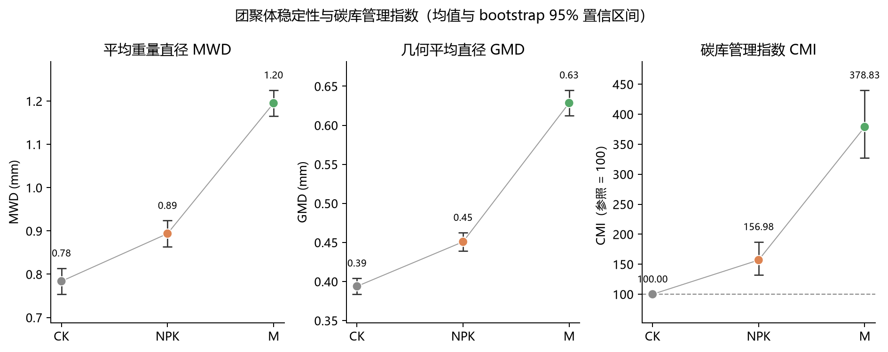

# aggcarbon

把湿筛团聚体数据变成可复核的稳定性与碳库指标（MWD、GMD、R>0.25、ESM 校正储量、POC/MAOC、LI、CPI/CMI），带 bootstrap 区间、图表和中文报告。

[](https://github.com/uppercrusteve/aggcarbon/actions/workflows/ci.yml)
[](LICENSE)
[](https://www.python.org/)
[](#测试)



## 为什么做

团聚体分级数据落到 Excel 后，MWD/GMD、等效土壤质量（ESM）、POC/MAOC 与 CPI/CMI 往往由不同人用不同公式拼出来：平均直径口径不一致、容重校正漏做、参照处理随手换、置信区间缺失，最后报告无法复核。aggcarbon 把这些步骤固定成一条命令：输入一份明确的 CSV，输出统一口径的指标、区间、图、JSON 与可直接归档的中文报告。

## 安装

需要 Python 3.10+。推荐虚拟环境。

Windows PowerShell：

```powershell
py -3.12 -m venv .venv
.\.venv\Scripts\Activate.ps1
python -m pip install -e .
aggcarbon --help
```

macOS / Linux：

```bash
python3 -m venv .venv
source .venv/bin/activate
python -m pip install -e .
aggcarbon --help
```

## 快速开始

仓库自带合成演示数据 `examples/aggregates_demo.csv`（3 处理 × 3 block × 2 伪重复，**非实测**）：

```bash
aggcarbon validate examples/aggregates_demo.csv
aggcarbon compute examples/aggregates_demo.csv --reference CK -o out --bootstrap 2000
aggcarbon template -o template.csv
```

`compute` 会在 `out/` 写出：

- `summary.csv`：处理均值、SD、95% CI、MWD、GMD、R>0.25、SOC/POC/MAOC 储量、LI、POC/MAOC、CPI、CMI
- `stocks_by_class.csv`：逐样品逐粒级储量（含 ESM 倍率）
- `result.json`：元数据、逐样品指标与全部区间
- `report.md`：中文报告（公式、单位表、结果、局限，可改名作实验室内部说明）
- `aggregate-stability.png`、`carbon-indices.png`

在真实数据上启用 ESM 时增加 `--reference-mass 2400`（单位 Mg/ha，取参照处理实测土壤质量）。

## 输入格式

UTF-8 CSV，一行一个“样品 × 粒级”。`#` 开头为注释行。

| 列 | 必填 | 含义 | 单位 |
|---|---|---|---|
| sample_id | 是 | 样品唯一编号 | — |
| treatment | 是 | 处理名；其中一组由 `--reference` 指定为参照 | — |
| block | 是 | 区组/重复；bootstrap 的重采样单元 | — |
| aggregate_class_mm | 是 | 固定为 `>2`、`1-2`、`0.25-1`、`<0.25` | mm |
| fraction_mass_g | 是 | 该粒级质量，每样品四类齐全且总和 > 0 | g |
| soc_g_kg | 是 | 粒级 SOC 浓度，0–200 | g/kg |
| bulk_density_g_cm3 | 是 | 容重，0.5–2.0；同一样品四行一致 | g/cm3 |
| depth_cm | 是 | 采样层厚，> 0 | cm |
| poc_g_kg | 否 | 颗粒态有机碳，非负；缺省则 CPI/CMI 为 NA | g/kg |
| maoc_g_kg | 否 | 矿物结合态有机碳，非负 | g/kg |

`aggcarbon template -o template.csv` 生成带注释的模板。校验失败会逐行列出问题并以退出码 2 结束。

## 输出与口径

- MWD = Σ(p_i·d_i)，d_i 取 4、1.5、0.625、0.125 mm；GMD = exp(Σ p_i·ln d_i)；R>0.25 为三类大团聚体比例。
- 储量以 `M = BD × depth × 100`（Mg/ha）计算，`stock_i = M·p_i·SOC_i/1000`。
- `--reference-mass` 给定时所有储量乘 `M_ref/M_sample`；浓度与 MWD/GMD/R>0.25 不变。
- CPI = POC_treat/POC_ref；CMI = CPI × (SOC_treat/SOC_ref) × 100；参照处理固定 100。
- 区间为处理内按 block 的 percentile bootstrap（默认 2000 次，seed 42）。

完整公式、单位、假设、文献与局限见 [`docs/methods.md`](docs/methods.md)；报告结构见 [`docs/report-template.md`](docs/report-template.md)。

**主要局限**：名义平均直径是惯例近似；容重应分层实测；CMI 依赖参照选择，跨试验不可直接比较；bootstrap 在 block 少时区间偏窄。

## 数据来源

`examples/aggregates_demo.csv` 为**合成演示数据**，由固定规则生成，仅用于跑通流程，不代表任何真实试验。CSV 顶部与 `examples/README.md` 均有标注。公开数据与实测数据的引用请在使用者自己的报告中补充。

## 测试

```bash
python -m pytest -q
python -m ruff check .
```

60 个测试覆盖手算 MWD/GMD/R>0.25、ESM 倍率、CPI/CMI 定义与参照=100、bootstrap 复现、缺粒级/负质量/容重越界/空参照等错误输入、输出列齐全与 CLI 退出码。

## 引用

```bibtex
@software{aggcarbon2026,
  author  = {uppercrusteve},
  title   = {aggcarbon: soil aggregate stability and carbon pool indices calculator},
  year    = {2026},
  version = {0.1.0},
  url     = {https://github.com/uppercrusteve/aggcarbon},
  license = {MIT}
}
```

## English summary

aggcarbon is a small, dependency-light command line tool for wet-sieving data.
It computes aggregate stability indices (MWD, GMD, R>0.25), equivalent-soil-mass
corrected SOC/POC/MAOC stocks, and the carbon pool index (CPI) and carbon
management index (CMI), with block-bootstrap confidence intervals, CSV/JSON
outputs, figures, and a Chinese laboratory report. Inputs are validated against
fixed aggregate classes and documented ranges. The demo dataset is synthetic.
Formulas, sources, assumptions, and limitations are in `docs/methods.md`.

## License

MIT © 2026 uppercrusteve. See [`LICENSE`](LICENSE).
